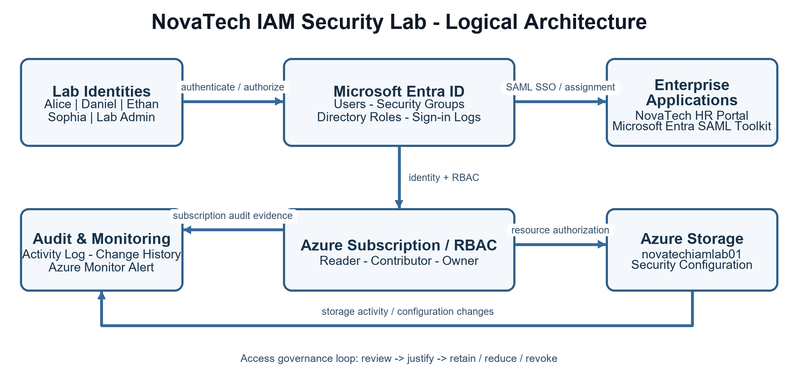

# NovaTech Identity & Access Management Security Lab

Hands-on Microsoft Entra ID and Azure IAM security lab for a fictional organisation, NovaTech.

## Project summary

This project demonstrates practical identity lifecycle management, least-privilege access control, SAML single sign-on, Azure RBAC, audit investigation, monitoring, offboarding, and manual access governance.

The lab was built and tested in Microsoft Entra ID and Microsoft Azure using five lab identities, role-oriented security groups, enterprise applications, Azure Storage, subscription-level RBAC, Activity Log, change history, and Azure Monitor alerting.

## Latest validation: reusable Joiner–Mover–Leaver workflow

[Jordan Ellis's live JML validation](jml/jordan-live-validation.md) records preview and apply for all three stages on 22 November 2026, using PowerShell 7.7.0 and delegated Graph access. The validation covered one fictional user and two pinned groups. Six sanitized screenshots show the stage results, disabled account, audit events and final Groups page with no memberships.

## Original JML case study: Maya Chen

[Maya Chen's identity lifecycle case study](jml/README.md) documents a later extension completed on 19–20 November 2026. I used Microsoft Graph PowerShell for account creation, department and group changes, and account disablement, then completed session revocation and final group removal in the Entra portal. The case study includes 17 sanitized screenshots covering successful outcomes, group checks and audit verification.

The [reusable workflow](jml/workflow/README.md) defaults to dry run and requires explicit apply, with tenant/user/group validation and partial-failure reporting. Jordan's later run validated it in the live lab, including the explicit portal-verification switch required for null group role-assignability responses. The original 15 offline checks are retained; the expanded harness passes 39 mock checks. First-sign-in behaviour and active application-session termination were outside the live test scope.

## Security capabilities demonstrated

- Entra users, groups, and directory roles
- Least-privilege role design using Helpdesk Administrator and Security Reader
- Azure RBAC testing with Reader and temporary Contributor access
- Microsoft Entra SAML Toolkit and NovaTech HR Portal assignment
- SAML troubleshooting involving ACS/Reply URL and NameID configuration
- Azure Activity Log and change-history investigation
- Administrative-operation monitoring and email alerting
- Leaver offboarding with account disablement and entitlement removal
- Manual access review when native Access Reviews were unavailable in the tenant

## Architecture

The architecture separates identity, enterprise applications, Azure authorization, storage, and audit/monitoring. Identity flows from lab users through Microsoft Entra ID to enterprise applications; Entra authorization flows to Azure subscription/RBAC and Azure Storage; subscription and storage activity feed Audit & Monitoring.

## Repository contents

| Path | Purpose |
|---|---|
| `jml/README.md` | Maya Chen historical JML case study and follow-up overview |
| `jml/jordan-live-validation.md` | Jordan Ellis live workflow validation and six evidence screenshots |
| `docs/project-summary.md` | Recruiter-friendly project summary and outcomes |
| `docs/limitations-and-lessons.md` | Confirmed limitations, troubleshooting, and lessons learned |
| `diagrams/architecture.png` | Corrected Figure 1 architecture diagram |
| `reports/NovaTech_IAM_Security_Lab_Final_Report.pdf` | Complete final portfolio report |

## Evidence and privacy

The original lab includes 41 reviewed, renamed, and sanitized screenshots. Maya's JML extension adds 17 sanitized screenshots in `jml/evidence/`; Jordan's follow-up adds six in `jml/evidence/jordan/`. Originals remain private in the source folder. Tenant, subscription, request, IP, certificate, and personal account details were redacted before publication.

| Evidence folder | Coverage |
|---|---|
| `evidence/identity-and-apps/` | Tenant, users, groups, and enterprise-application setup |
| `evidence/identity-lifecycle/` | User property change / mover scenario |
| `evidence/groups-rbac/` | Group membership and access-control evidence |
| `evidence/authentication/` | Allowed sign-in and denied password-reset evidence |
| `evidence/offboarding/` | Ethan Wilson disablement and session revocation |
| `evidence/audit-monitoring/` | Sign-in, audit-log, device, location, and authentication investigations |
| `evidence/access-review/` | Manual access-review evidence for lab identities |

The PDF in `reports/` is the original lab report. The later Maya Chen JML extension is documented separately in `jml/README.md`. A fixed-layout DOCX copy is retained locally where needed.

## Limitations

Native Entra Identity Governance Access Reviews and automated lifecycle workflows were not available in the lab tenant. Access governance was therefore completed manually and documented as a limitation and future enhancement. Conditional Access and PowerShell/Graph inventory automation are not claimed as completed controls in the original lab. Maya's JML extension documents specific Graph PowerShell operations and a portal fallback. Jordan's later live lab run validates preview and apply of the reusable workflow for one fictional user and two pinned groups; it does not establish production readiness or immediate termination of active application sessions.

## Author

Harsh Chaudhary  
Cybersecurity portfolio project | Microsoft Entra ID | Azure IAM
