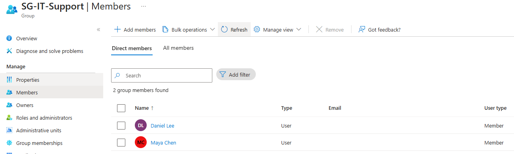
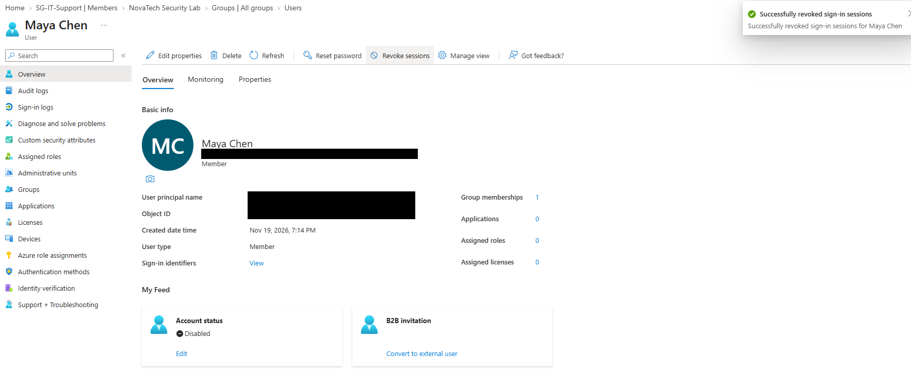

# NovaTech | Microsoft Entra ID identity lifecycle lab

**Harsh Chaudhary · Personal portfolio project · 19–20 November 2026**

I managed a fictional employee, Maya Chen, through joining IT Support, moving to Development and leaving NovaTech. I used Microsoft Graph PowerShell for account creation, department changes, group membership changes and account disablement. I completed session revocation and the final group removal in the Microsoft Entra admin center after encountering a PowerShell command error and a blocked reconnection attempt.

This case study demonstrates identity administration, access removal, troubleshooting and evidence checking in a personal lab. NovaTech is fictional; this is not paid IAM employment or a production deployment.

## Scenario and tools

| Stage | Required outcome | Actual method and result |
|---|---|---|
| Joiner | Give Maya the lab membership for IT Support | Graph PowerShell created her account with department IT Support, submitted a password profile requiring a change at first sign-in, and added her to SG-IT-Support. |
| Mover | Replace IT Support membership with Development membership | Graph PowerShell removed SG-IT-Support membership, added SG-Developers membership and changed her department to Development. |
| Leaver | Disable the account, revoke sessions and remove remaining lab membership | Graph PowerShell disabled the account. The Entra portal completed session revocation and removal from SG-Developers. |

My recorded setup was PowerShell 7.7.0 and Microsoft Graph Authentication, Users and Groups modules 2.41.2, using delegated access to the NovaTech Security Lab. These version details come from my lab notes; the selected screenshots do not independently establish every module version. Earlier NovaTech work covered users and groups, MFA, SAML SSO troubleshooting, Azure Storage RBAC, monitoring and a manual access review. That work is background rather than evidence for this JML exercise. Ethan Wilson's earlier disabled account is separate from Maya's offboarding.

## Joiner: establish the intended membership

Before onboarding, SG-IT-Support showed Daniel Lee as its only direct member. After the scripted creation and membership addition, it showed Daniel and Maya. The original PowerShell capture records `New-MgUser`, the IT Support department and `ForceChangePasswordNextSignIn = $true`. This establishes the submitted configuration, not that Maya actually completed a first sign-in or changed her password.

[Before: Daniel only](evidence/01-joiner-before.png) · [After: Daniel and Maya](evidence/02-joiner-after.png) · [Creation command and password policy](evidence/19-joiner-powershell.png)

## Mover: remove the old membership and verify both groups

I removed Maya from SG-IT-Support before adding her to SG-Developers, then updated her department. PowerShell returned **Maya Chen — Development**. The portal showed Maya as the only direct member of SG-Developers and Daniel as the only direct member of SG-IT-Support.

[Department output](evidence/03-mover-powershell.png) · [Destination membership](evidence/04-mover-developers.png) · [Source membership](evidence/05-mover-it-support.png)

These checks demonstrate the intended directory changes and avoid retaining the old lab membership. They do not demonstrate application provisioning or a successful application sign-in.

## Least-privilege checks and their limits

I inspected both groups before completing the workflow. The screenshots show:

| Check | SG-IT-Support | SG-Developers |
|---|---|---|
| Security group; Assigned membership; Entra role assignment capability set to No | [Properties](evidence/11-it-support-properties.png) | [Properties](evidence/15-developers-properties.png) |
| No parent groups displayed | [Group memberships](evidence/12-it-support-parent-groups.png) | [Group memberships](evidence/16-developers-parent-groups.png) |
| No application assignments displayed | [Applications](evidence/13-it-support-applications.png) | [Applications](evidence/17-developers-applications.png) |
| No Azure role assignments displayed in Azure subscription 1 | [Azure roles](evidence/14-it-support-azure-roles.png) | [Azure roles](evidence/18-developers-azure-roles.png) |

These are point-in-time portal observations within the selected views and the administrator's visibility. The Azure blade explicitly warns that unreadable assignments are omitted. They do not establish the absence of access in every subscription, direct user grants, application-side permissions or other authorization paths. The role-assignment setting describes group capability; it is not a complete privilege audit of Maya or the administrator.

## Leaver: complete offboarding with a portal fallback

I disabled Maya's account through Graph PowerShell. When session revocation was unavailable in that session and a later reconnection attempt was blocked, I kept Security Defaults enabled and completed session revocation and the remaining group removal in the Entra portal.

The [portal confirmation](evidence/06-leaver-disabled-revoked.png) shows Maya's account disabled and successful sign-in-session revocation. At that moment it still shows one group membership. The later [refreshed Developers list](evidence/07-leaver-developers-empty.png) shows zero direct members after removal. I verified these separately rather than treating the earlier overview as the final membership state.

Session revocation acknowledgement and the related audit update do not prove immediate termination of every active access token or application session. Microsoft documents refresh-token and browser-session invalidation with possible processing delay: [revokeSignInSessions](https://learn.microsoft.com/en-us/graph/api/user-revokesigninsessions?view=graph-rest-1.0). I did not perform a fresh end-to-end application-access test.

## Audit verification

The [Maya audit view](evidence/10-maya-audit.png) is displayed as **Local** time. The following times are transcribed as shown, without asserting a particular time-zone offset. All listed rows show **Success**.

| Displayed local date and time | Activity | Visible source actor |
|---|---|---|
| 19 Nov 2026, 7:14:43 PM | Add user; Update PasswordProfile | Microsoft Graph Command Line Tools |
| 19 Nov 2026, 7:15:27 PM | Add member to group | Microsoft Graph Command Line Tools |
| 19 Nov 2026, 11:08:03 PM | Remove member from group; Add member to group; Update user | Microsoft Graph Command Line Tools |
| 19 Nov 2026, 11:12:57 PM | Disable account; Update user | Microsoft Graph Command Line Tools |
| 20 Nov 2026, 8:29:30 AM | Update StsRefreshTokenValidFrom Timestamp; Update user | Administrator account, identifying label redacted |
| 20 Nov 2026, 8:30:33 AM | Remove member from group | Administrator account, identifying label redacted |

The source's administrator actor label is an account identifier; the portal method is established by the accompanying portal captures and my lab notes. The audit list does not expose each changed property's values, so I used the department output and membership screenshots to corroborate the resulting state. Redactions remove target identifiers and personal actor labels while preserving activity, status, timestamps and Graph actor labels.

## Follow-up: Jordan Ellis live workflow validation

On 22 November 2026, I validated preview and apply for all three stages of the [reusable PowerShell workflow](workflow/README.md) in the live NovaTech lab with Jordan Ellis, one fictional user, and two pinned groups. The [Jordan validation write-up](jordan-live-validation.md) includes six redacted screenshots, the null group role-assignability issue, the explicit portal-verification control and the final Groups page showing no memberships.

This follow-up is separate from Maya's 19–20 November hybrid workflow documented above. The reusable script was not used to produce Maya's evidence. The original 15 offline mock results remain historical; the expanded harness now passes 39 mock checks. Jordan's first-sign-in behaviour and active application-session termination were outside the live validation scope.
