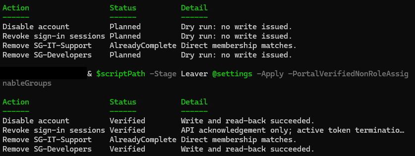

# Jordan Ellis | Live JML workflow validation

**Harsh Chaudhary · Personal NovaTech lab · 22 November 2026**

I ran preview and apply for Joiner, Mover and Leaver using the reusable PowerShell workflow against my live Microsoft Entra lab. The validation covered **one fictional user, Jordan Ellis, and two pinned groups**, SG-IT-Support and SG-Developers. This follow-up validates the reusable workflow separately from [Maya Chen's earlier hybrid PowerShell and portal case study](README.md).

## Setup and tested script

The run used PowerShell 7.7.0 and delegated Microsoft Graph access. The session-revocation command was available from Microsoft.Graph.Users.Actions 2.41.2. These environment details are recorded in my run notes; the leaver capture displays command version 2.41.2 but truncates its source-module name.

The repository's [Invoke-NovaTechJml.ps1](workflow/Invoke-NovaTechJml.ps1) was updated from the exact Windows copy used for this run. Its execution body matches that tested copy; only its introductory validation-status comment was updated afterwards. The main functional change from the earlier version is the handling of a null group role-assignability response and the explicit portal-verification switch.

## Group validation issue and resolution

Graph returned `isAssignableToRole: null` for both existing groups, including in a direct Graph request. The earlier check required an explicit `false`, so it blocked the run. I checked the pinned group Object IDs in the Entra portal and verified that neither group could be assigned an Entra role. This diagnosis and portal check are recorded in my run notes; the six outcome images below do not independently show those property checks.

The tested script treats the returned value as follows:

| Graph value | Preview | Apply |
|---|---|---|
| `false` | Allowed, subject to other checks | Allowed, subject to other checks |
| `true` | Blocked | Blocked, even with the portal switch |
| `null` / blank | Allowed without writes | Blocked unless `-PortalVerifiedNonRoleAssignableGroups` is supplied |

The switch is the operator's explicit attestation that **both pinned IDs and their non-role-assignable state were verified in the portal**. It does not query or prove the portal state, and the script does not create a separate verification record. Retain the approval and invocation privately. A blank Graph response alone is insufficient for live writes. Exact group ID/name, assigned security-group, cloud-only, tenant and target-user checks remain in place.

## Verified outcomes

| Stage | Result | Evidence |
|---|---|---|
| Joiner | PowerShell verified creation, enabled state and department IT Support, then direct membership in SG-IT-Support. The password-change-at-first-sign-in requirement was submitted. | [Joiner apply results](evidence/jordan/01-joiner-apply.png) |
| Mover | PowerShell verified removal from SG-IT-Support, addition to SG-Developers and department change to Development. | [Mover apply results](evidence/jordan/02-mover-apply.png) |
| Leaver | PowerShell verified account disablement and removal from SG-Developers. Removal from SG-IT-Support reported AlreadyComplete. Graph acknowledged sign-in-session revocation. | [Leaver preview and apply](evidence/jordan/03-leaver-preview-apply.png) |
| Account state | Entra Overview showed Disabled. Its group count still displayed one, so it was not used as the final membership check. | [Disabled account](evidence/jordan/04-account-disabled.png) |
| Audit | Successful user/group events and a refresh-token validity timestamp update were recorded with Microsoft Graph Command Line Tools as actor. | [Audit log](evidence/jordan/05-audit-log.png) |
| Final membership | The later Entra Groups page showed **Not a member of any groups**. | [Final Groups page](evidence/jordan/06-final-no-memberships.png) |

The terminal tables show workflow verification summaries, not every returned property value. The submitted password policy comes from the tested script and run notes; the joiner detail is truncated in the screenshot. First-sign-in behaviour was outside the test scope.

## Audit corroboration

The screenshot displays **Local** time on 22 November 2026. All listed lifecycle events show Success and Microsoft Graph Command Line Tools as actor:

- 4:10:17 PM: Add user and Update PasswordProfile; 4:10:19 PM: Add member to group.
- 4:16:02 PM: Remove member from group and Add member to group; 4:16:03 PM: Update user.
- 4:55:00 PM: Disable account and Update user.
- 4:55:01 PM: refresh-token validity timestamp update, Update user and Remove member from group.

The timestamp-update activity label is truncated in this list view. The run notes identify it as the successful refresh-token validity timestamp update. The list also does not expose the changed department or group target IDs after redaction; the workflow results and final Groups page supply the accompanying state checks.

## Validation limits

This was a live lab validation with one fictional identity and two pinned groups. It does not establish production readiness, broad tenant coverage, every failure path or effective application authorization. Active application-session termination was outside the test scope. Graph acknowledgement and an audit timestamp update do not prove immediate termination of every active access token or application session.

The original 15 offline mock checks remain historical results. The updated [mock harness](workflow/Test-Workflow.ps1) now passes **39 checks**, adding 24 combinations for explicit false, explicit true and null across preview/apply, the portal switch present/absent, and each pinned group independently. These regression checks use mocks only; no live lifecycle run was repeated while preparing this update.

Maya's original screenshots and historical hybrid workflow are preserved. See the [workflow runbook](workflow/README.md) for operational controls and the portal fallback.
